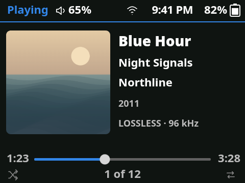
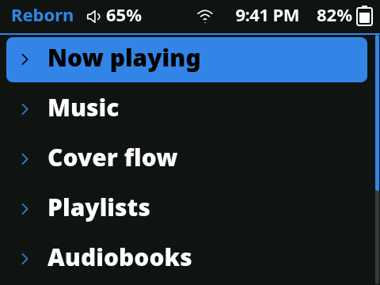
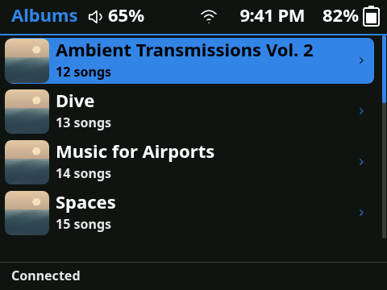
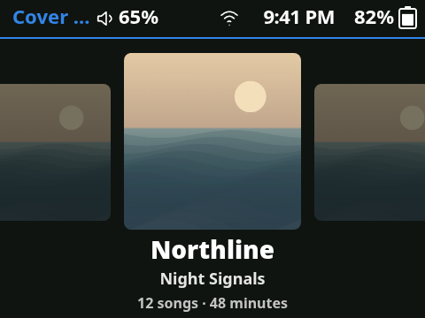
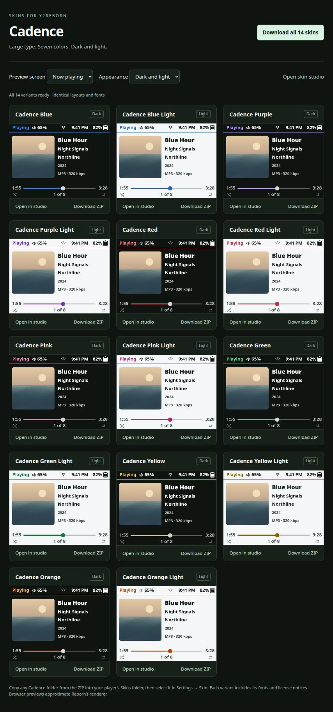

# Cadence

**Large-font skins with visible album art for the Innioasis Y2 running [Y2Linux](https://github.com/SchulzCode/Y2Linux) and [Y2Reborn](https://github.com/SchulzCode/Y2Reborn).**

Cadence is made for people who want large, readable fonts but also want to see their album artwork. It combines the large type and five-row menus of Reborn’s Big Type skin with a compact, cover-led Now Playing layout inspired by [Adwaitapod Focus](https://github.com/Porroe/adwaitapod-focus).

[Download Cadence 1.0](https://github.com/Porroe/cadence-skins/releases/tag/v1.0) · [All releases](https://github.com/Porroe/cadence-skins/releases)

## Screenshots

Cadence Blue, shown at the player’s native **480 × 360** resolution:

| Now Playing | Home |
| --- | --- |
|  |  |

| Library | Cover Flow |
| --- | --- |
|  |  |

These are browser-rendered previews. Native screens, including Cover Flow, can differ on the player. The sample album artwork is illustrative and is not included in the skins.

## Features

- Large, readable menus and metadata using the original Big Type font files.
- **204 × 204** album artwork beside the track information on Now Playing.
- Enlarged **24 px** option values such as On/Off.
- A consistent status bar with volume, Wi-Fi, Bluetooth, clock, battery percentage, and charging state.
- Sleep timer and favorite indicators, blue or color-matched selection highlights, and space beside list scrollbars.
- **14 skins:** seven colors, each in dark and light versions.

## Colors

| Color | Dark | Light |
| --- | --- | --- |
| Blue | [Cadence Blue](skins/CadenceBlue) | [Cadence Blue Light](skins/CadenceBlueLight) |
| Purple | [Cadence Purple](skins/CadencePurple) | [Cadence Purple Light](skins/CadencePurpleLight) |
| Red | [Cadence Red](skins/CadenceRed) | [Cadence Red Light](skins/CadenceRedLight) |
| Pink | [Cadence Pink](skins/CadencePink) | [Cadence Pink Light](skins/CadencePinkLight) |
| Green | [Cadence Green](skins/CadenceGreen) | [Cadence Green Light](skins/CadenceGreenLight) |
| Yellow | [Cadence Yellow](skins/CadenceYellow) | [Cadence Yellow Light](skins/CadenceYellowLight) |
| Orange | [Cadence Orange](skins/CadenceOrange) | [Cadence Orange Light](skins/CadenceOrangeLight) |

<details>
<summary>View the complete color collection</summary>



</details>

## Install on your Innioasis Y2

1. Your player must be running **Y2Linux with Y2Reborn** and support format 1 custom skins.
2. Download **Cadence-1.0.zip** from [Releases](https://github.com/Porroe/cadence-skins/releases/tag/v1.0) and extract it on your computer.
3. Connect the player over USB. Create a folder named **Skins** on Internal Storage or the SD card if needed.
4. Copy any of the extracted **Cadence…** folders into **Skins**. Copy the whole folder, including its fonts and license notices.
5. Safely eject the player. Open **Settings → Skin** and select the installed Cadence variant.

For example:

```text
Skins/
└── CadenceBlue/
    ├── skin.json
    ├── LICENSE.txt
    ├── README.txt
    └── fonts/
        ├── NotoSans-Bold.ttf
        ├── NotoSans-Black.ttf
        └── Noto-OFL.txt
```

You can install several variants at once. To update one, replace its complete folder, then reopen **Settings → Skin** and select it again.

## Customize and build

Each skin lives in its own folder under `skins/`. Edit that folder’s `skin.json` to change its colors or layout. See the [Y2Reborn skin documentation](https://github.com/SchulzCode/Y2Reborn/blob/main/docs/skins.md) for supported fields and limits.

Build the installable release ZIP with Python 3; no additional packages are required:

```sh
python3 scripts/build-release.py
```

The script validates the manifests, font files, names, and versions, then writes `releases/Cadence-1.0.zip` and its SHA-256 checksum. Generated releases are excluded from Git; the ZIP is attached to the GitHub release.

This repository contains the skins and a packaging script. The browser theme viewer/editor is not included.

## Credits and licenses

- **Original skin:** Cadence is adapted from the [Big Type skin bundled with Y2Reborn](https://github.com/SchulzCode/Y2Reborn/tree/main/skins/big-type), by the Reborn contributors. The original MIT license is retained in [LICENSE](LICENSE) and each skin folder.
- **Visual inspiration:** [Adwaitapod Focus by Porroe](https://github.com/Porroe/adwaitapod-focus), itself based on [Adwaitapod by Dook](https://github.com/D0-0K/adwaitapod). Its cover-led Now Playing design informed Cadence’s layout. No Rockbox theme files or artwork are bundled here.
- **Fonts:** Original Noto Sans font files from the Big Type skin are included unchanged, with their original license notice in each `fonts/Noto-OFL.txt` file.

Cadence is a community skin collection for the Innioasis Y2. It is not the Y2Linux firmware or the Y2Reborn player application.
